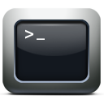

# SBEmacs commands

**How to type a command.**
`C-` is the `Ctrl` key and `M-` is the `Esc` key.

|         |                                                                    |
| :------ | :----------------------------------------------------------------- |
| C-f     | Keep `Ctrl` down and press `f`.                                    |
| M-f     | Press `Esc` and let go of it, then press `f`.                      |
|         | or keep `Alt` (`Option` on a Mac) down and press `f`.              |
| C-x C-s | Keep `Ctrl` down and press `x`, then `s`. Then let go of `Ctrl`.   |
| C-x b   | Keep `Ctrl` down and press `x`. Let go of `Ctrl`, then press `b`.  |
| C-M-f   | Press `Esc` and let go of it, then keep `Ctrl` down and press `f`. |

-----

**Files** 

|           |                        |
| :-------- | :--------------------- |
| `C-x C-f` | open a file            |
| `C-x C-s` | save                   |
| `C-x C-w` | save with another name |
| `C-x i`   | insert a file          |
| `C-x C-c` | quit                   |

**Moving**  

|            |                            |
| :--------- | :------------------------- |
| `C-f  C-b` | forward, back one char     |
| `C-n  C-p` | next, previous line        |
| `M-f  M-b` | forward, back one word     |
| `C-a  C-e` | beginning, end of the line |
| `C-v  M-v` | next, previous screen      |
| `M-<  M->` | beginning, end of the file |
| `M-g`      | go to a line number        |

**Editing**  

|         |                               |
| :------ | :---------------------------- |
| `BkSp`  | delete char before the cursor |
| `C-d`   | delete char under the cursor  |
| `C-k`   | kill to end of line           |
| `C-/`   | undo; again: undo more        |
| `C-M-_` | redo                          |
| `TAB`   | indent the line               |
| `M-q`   | refill the paragraph          |
| `M-;`   | comment line or region        |


**Code blocks**
In Markdown, commands such as `M-;` (comment line) and `TAB` (indent the line)
work only in code blocks, and obey the syntax of the computer language you are
editing.

```Scheme
(define (fib n)
  (if (< n 2)
      (+ (fib (- n 2))
         (fib (- n 1)) )))

```

**Region (shaded)**  

|         |                            |
| :------ | :------------------------- |
| `C-Spc` | set mark                   |
| `mouse` | drag to select             |
| `C-w`   | kill region                |
| `M-w`   | copy the region            |
| `C-y`   | yank (paste)               |
| `M-y`   | after C-y: an earlier kill |
| `C-g`   | cancel command             |

**Searching**  

|       |                 |
| :---- | :-------------- |
| `C-s` | search forward  |
| `C-r` | search backward |
| `M-%` | replace         |

**Buffers and windows**  

|           |                                                  |
| :-------- | :----------------------------------------------- |
| `C-x b`   | choose a buffer from a filtered, completing list |
| `C-x C-b` | buffer menu                                      |
| `C-x 2`   | split the window                                 |
| `C-x o`   | other window (or click it)                       |
| `C-x 0`   | close this window                                |
| `C-x 1`   | close other window                               |

**Help, Lisp and AI**  

|           |                         |
| :-------- | :---------------------- |
| `C-h`     | help with keybinding    |
| `M-x`     | run a command by name   |
| `M-:`     | eval a Lisp             |
| `C-x C-e` | eval Lisp before cursor |
| `C-c r`   | call Claude             |
| `C-c y`   | insert Claude’s code    |
| `C-c g`   | call Codex/ChatGPT      |
| `C-c q`   | close Codex/Claude      |

# The commands in detail

This chapter explains the commands on the first page in more detail.
The next chapter shows how to install and run Browsered.

In the following cheat sheet, `Spc` denotes
the space bar, `C-` is the `Ctrl` prefix, `M-` represents
the `Alt` prefix, and κ can be any key.

### Help.

If you forget a command, press `C-h` or `F1`.
Browsered shows all its keybindings on a page of their own,
one key per line. The arrows, `C-n` and `C-p` scroll
the page; any other key takes you back to the file you are editing.

### The status line is a menu.

At the bottom of each window,
the status line shows the name of the file and the line where the
cursor is. An asterisk after the file name means that the file has
been modified, but not saved. Then come buttons that the mouse can
click:

> 
> 
>  fib.lisp*, L. 5  [?] [SAVE][UNDO][Select][MORE][TTFY][GRAMMAR] ...

A button does what its key does, so Nia, the Canadian
girl who is learning how to code, can work before she
learns the keys, and learn them from the buttons:

> 
> 
> |                  |           |                             |
> | :--------------- | :-------- | :-------------------------- |
> | `[?]` + 1        | `C-h`     | every key on one page       |
> | `[SAVE]`         | `C-x C-s` | save the file               |
> | `[UNDO]`         | `C-/`     | undo                        |
> | `[MORE]` Open    | `C-x C-f` | open a file                 |
> | `[MORE]` Copy    | `M-w`     | copy the selection          |
> | `[MORE]` Paste   | `C-y`     | paste                       |
> | `[?]` 2 or 3     |           | how to ask Claude or Codex  |
> | `[MORE]` Buffers | `C-x b`   | switch to another open file |
> | `[QUIT]`         | `C-x C-c` | leave SBEmacs               |
> | `[GRAMMAR]`      |           | Toggle Grammarly            |
> 

Grammarly is a pain in the ass, but if you need to write in English,
you have no choice. It's the only Computer-Aided Writing Tool that
gets past any AI detector. The [GRAMMAR] button lets you toggle
Grammarly on and off. Word of advice: when you're not using Grammarly,
leave it turned off.
  
The file name is a button too. A name longer than 18
characters is shortened at the front, as in
`...src/fib.lisp`. A click on the name opens a window with the
full name of the file, its number of lines, words, characters and
bytes, the line of the cursor, the language, and whether and when it
was saved. Any key closes that window.
To copy, Nia drags the mouse over the text and clicks
`[MORE] Copy`; she then clicks where the copy should go, and clicks
`[MORE] Paste`. A button lights up while she presses it, and acts
when she lets it go; if she changes her mind, she moves the mouse
off the button before letting go. If Nia leaves Browsered with
`[QUIT]` while a file is not saved, the Editor asks first.

The whole status line is written in Scheme, in
`scheme/extensions/menu.scm`. The buttons are a list,
`*mode-line-menu*`, which Nia can change in her init file:

> 
> 
>     (set! *mode-line-menu*
>           (append *mode-line-menu* '(("KILL" "C-x k"))))

### Basic commands.

`C-`κ – Keep `Ctrl` down
and press `κ`

> `C-s` then type some text, and press `C-s` again
> – search for text.  
> `C-r` then type some text, and press `C-r` again
> – reverse search.  
> `C-k` – kill a line.  
> `C-h` – help (the backspace key deletes backward).  
> `C-d` – delete char forward.  
> `C-Spc` then move the cursor – select a region.  
> `M-w` – save selected region into the kill ring.  
> `C-w` – kill region.  
> `C-y` – insert killed or saved region.  
> `C-g` – cancel minibuffer reading, or unselect the region.  
> `C-a` – go to beginning of line.  
> `C-e` – go to end of line.  
> `C-b` – move backward one character.  
> `C-f` – move forward one character.  
> `C-n` – move cursor to the next line.  
> `C-p` – move cursor to the previous line.  
> `C-l` – put the line of the cursor in the middle of the window.  
> `C-/` – undo. `C-u` also undoes.  
> `C-v` – forward page.  
> `INS` – toggle overwrite mode.  
> `←` `→` `↑` `↓` – arrows move cursor.  

### Control-x commands.

`C-x C-`κ – Keep `Ctrl`
down and press `x`, then `κ`

> `C-x C-f` – open a file into a new buffer.  
> `C-x C-w` – write file with new name.  
> `C-x C-s` – save file.  
> `C-x s` – save every modified file, asking first.  
> `C-x C-c` – exit Browsered.  
> `C-x i` – insert file at the cursor.  
> `C-x ?` – describes a key stroke.  
> `C-x @` – shell command. After `C-x @`,
> if one types `ls` at the prompt, the computer
> will list the current folder.
> It is possible to use any other shell command
> just like the `ls` example.

### Window commands.

One can have more
than one window on the screen. Below, you will
find commands that cope with this situation.

  - ` C-x  `κ – Keep `Ctrl` down and press `x`;
    let go of `Ctrl`, then press `κ`
    
    > `C-x b` – choose a buffer. Type to filter the visible list,
    > `Tab` completes the common prefix, the arrow keys select an entry,
    > `Enter` opens it, and `C-g` cancels. The previous buffer is
    > selected initially, so repeated use quickly alternates between two buffers.  
    > `C-x n` – next buffer.  
    > `C-x C-n` – next buffer. Same as above.  
    > `C-x C-b` – list buffers.  
    > `C-x k` – kill current buffer.  
    > `C-x =` – cursor position.  
    > `C-x 2` – split window into cursor window and other window.  
    > `C-x o` – jump to the other window.  
    > `C-x 1` – close the other window.  
    > `C-x 0` – close the cursor window.  
    > `C-x ^` – make the cursor window taller.
    > `C-^`   - make the cursor window taller.
      
  - `Esc` κ – Press the `Esc` key and let go of it,
    then press the `κ` key.
    
    > `Esc >` – go to the end of buffer.  
    > `Esc <` – go to the beginning of buffer.  
    > `Esc f` – word forward.  
    > `Esc b` – word backward.  

  - `M`-κ – Keep the `Alt` key
    down and press the `κ` key. On the Macintosh,
    the `Alt` key is called `Option`; in the Terminal
    application, you must tick *Use Option as Meta key*
    in Settings, Profiles, Keyboard. In iTerm2, open Settings,
    Profiles, Keys and set *Left Option key* to *Esc+*.
    The right Option key may remain *Normal* for entering Mac symbols.
    
    > `M-b`   – move backward one word.  
    > `M-f`   – move forward one word.  
    > `M-g`   – go to the line given in the minibuffer.  
    > `C-x →` – activate the next buffer.  
    > `C-x ←` - activate the previous buffer.
    > `M-r`   – query replace. `M-%` does the same.

### The mouse.

You can click on a window to move
the cursor there; a click on another window selects that window.
If you keep the button down and drag the mouse, you select a region.
This works in the graphical window and in the text terminal.
In a text terminal, SBEmacs takes the mouse from the terminal; if
you want the terminal’s own selection, hold down the `Shift`
key (the `Option` key in the Macintosh Terminal) while
you drag, or start the Editor with the `--no-mouse` option.

### The region.

The region is the text between the mark,
which you set with `C-Spc`, and the cursor. Like in Emacs,
SBEmacs shades the region while it is active. The shade goes away
when you change the text, when you copy the region with `M-w`,
or when you press `C-g`.

### Query replace.

If you press `Esc``r`,
the computer enters in the query replace mode.
First, Browsered prompts for the text snippet S
that you want to replace. Then it prompts for
the replacement R. When you type the R text and
press the `Enter` key, the cursor jumps to
the first occurence of S, and SBEmacs
asks whether you want to
replace it. If the answer is
`y`, Browsered will replace S
with `R` and jump to the next occurence.
If the answer is `n`, SBEmacs will
jump to the next occurrence of S without
performing the replacement.

### Go to line.

When you try to compile
code containing errors, the compiler
usually reports the line number where the error occurred.
If you press `Esc``g`, Browsered
prompts for a line number. As soon as you
type the number and press the `Enter`
key, the cursor jumps to the line where the
error occurred.

In order to know the position of the cursor,
press the `C-x =` command,
and SBEmacs gives information concerning
the character under the
cursor, the corresponding code, the line,
and the character position in the text.

### Markdown.

Browsered colours Markdown files (`.md`):
headings, `**strong**` and `*emphasis*`, code between back
quotes, links, quotations and lists. A block of code that names its language,
like ` ```lisp `, is coloured as that language. In a list,
`Enter` starts the next item, ` -  ` or ` 3. `;
`Enter` on an empty item ends the list. `Tab` nests an item under
the item above, and `M-q` refills a paragraph or a list item.

### Undo.

The `C-/` command undoes the last
command. If you press it again, it undoes the command before,
and so on. Typed text is undone a word at a time, and a command
that changed many lines, like `M-q` (fill paragraph), is undone
at once. If you undo too much, `C-M-_` (or `M-_`) redoes
what undo took back. When you undo all the changes made since the
file was saved, the asterisk disappears from the status line.

### Nia Vardalos.

In order to get acquainted with editing and scripting,
let us accompany the Canadian programmer Nia
Vardalos, while she explores Browsered.

When text is needed for carrying out a command,
it is read from the minibuffer, a one line
window at the bottom of the screen. For instance,
if Nia presses `C-s` for finding a text,
the text is read from the minibuffer. After
typing the text that she wants to localize,
Nia presses `C-s` again to start the search.
For abandoning an ongoing command, she may press `C-g`.

To transport a region from one place to another,
Nia presses `C-Spc` to start
the selection process
and move the cursor to select the region.
Then she presses `C-w` to
kill her selection. Finally, she moves
the cursor to the insertion place,
and presses the `C-y` shortcut.
Of course, she can select the region with the mouse instead.

To copy a region, Nia presses `C-Spc` and moves the cursor to select the region.
Then she presses `M-w` to save the selection into the kill ring. Finally,
she takes the cursor to the destination where the copy is to be inserted and
issues the `C-y` command. If she wants an earlier kill,
she presses `M-y` right after `C-y`, and Browsered replaces
the yanked text with the kill before it.

The kill ring and the system clipboard work together, as in
Emacs. Whatever Nia kills or copies with `C-w`, `M-w` or
`C-k` also goes to the clipboard, so she can paste it into any
other program. And when she copies something in another program,
say a paragraph in her browser, `C-y` inserts it, and it joins
the kill ring; `M-y` then goes on to her older kills. In a
terminal, Browsered reaches the clipboard through `pbcopy` and
`pbpaste` on the Macintosh, and through `wl-copy` or
`xclip` on Linux (install one of them); in a window, it needs
nothing.

When Nia selects text by dragging the mouse, Browsered copies it to the
clipboard at once: `Cmd-V` pastes it in her browser, and she
never needs `Cmd-C`. In fact, in a terminal `Cmd-C` finds
nothing to copy, because Browsered takes the mouse for itself (that is
how the buttons of the status line work); iTerm2 then complains that
mouse reporting has prevented making a selection. The text is
already on the clipboard. If Nia wants the terminal’s own selection,
she keeps `Option` down while she drags.

Nia noticed that there are two equivalent ways to
issue an `M-`κ command. She can
press and release the `Esc` key, then
strike the κ key. Alternatively, she
can keep the `Alt` key down and press
the `κ` key.

### Calculations with Lisp.

Browsered offers a Lisp Scheme dialect to perform calculations and
text processing. Let us assume that you want to find how many students
graduate from medical schools in California. You press `Esc``:` and
Browsered will prompt you for a Lisp expression.

> `> (+ 190 180 170 160 120 100 100 90)``Enter`

In the above expression, the first thing after
the open parenthesis is the `+` sum
operation identifier. After the name of
the operation, there is a list of
the arguments to be added together.
As soon as Nia presses the `Enter` key,
Browsered shows the result of the addition:

> `1110`

The rule that worked for
the `(+ x₁ x₂ …)`
sum operation also works for the
other arithmetic function too.

  - Multiplication is performed
    by the `*` operation.
    
    > `Esc``:`  
    > `> (* 1 2 3 4 5)``Enter`  
    > 120

  - Division is obtained through the `/` operation.
    
    > `Esc``:`  
    > `> (/ 1 2 4)``Enter`  
    > 0.125
    
    The above operation performed the chain
    division `1/2/4`.
    
  - Subtraction has the syntax shown below.
    
    > `Esc``:`  
    > `> (- 1 2 4)``Enter`  
    > \-5

  - Mixed operations. One can nest subexpressions
    within an outer expression. For instance,
    to get the average student number graduating
    from medical school in California, one can
    calculate the expression:
    
    > `Esc``:`  
    > `> (/ (+ 190 180 170 160 120 100 100 90) 8.0)``Enter`  
    > 138.75


### Command execution.

When you press shortcut keys, Browsered calls a command written in C
or in Scheme. You can get a complete list of all Browsered keybindings
by pressing `C-h`.

There are commands that are not associated to shortcut keys. For
instance, the `undo-status` command tells how many steps of undo the
buffer keeps. Press `Esc``x` and type `undo-status` at the minibuffer
prompt. The `Tab` key completes the name of the command. Below you
will find a fairly complete list of Browsered commands.

### Moving.

    C-f          forward one character (also the right arrow)
    C-b          back one character (also the left arrow)
    C-n          next line (also the down arrow)
    C-p          previous line (also the up arrow)
    M-f          forward one word
    M-b          back one word
    C-a          beginning of the line
    C-e          end of the line
    M-m          first non-blank character of the line
    M-a          back to the start of the sentence
    M-e          forward to the end of the sentence
    M-{          back one paragraph
    M-}          forward one paragraph
    C-v          next screen
    M-v          previous screen
    M-<          beginning of the file
    M->          end of the file
    M-g          go to a line number
    C-l          put the cursor's line in the middle of the window
    C-M-f        forward over an expression (Lisp: an s-expression)
    C-M-b        back over an expression
    C-M-u        out to the enclosing parenthesis
    C-M-d        into the next parenthesis
    C-M-a        beginning of the definition (defun, function)
    C-M-e        end of the definition

### Selecting.

The region is shaded.

    C-Spc        set the mark: the region runs from it to the cursor
    mouse        click to move the cursor or choose a window;
                 drag to select
    C-x h        select the whole file
    M-h          select the paragraph
    M-@          select to the end of the word
    C-M-Spc      select to the end of the expression
    C-x C-x      swap the cursor and the mark
    C-g          unselect; cancel a command

### Killing (cutting) and yanking (pasting).

    C-w          kill the region
    M-w          copy the region
    C-y          yank the last kill
    M-y          right after C-y: replace it with the kill before
    C-k          kill to the end of the line (again: joins the kills)
    M-d          kill the next word
    M-DEL        kill the previous word
    M-k          kill to the end of the sentence
    C-M-k        kill the next expression
    M-z          kill up to and including a character
    C-d          delete the character under the cursor
    DEL          delete the character before the cursor (Backspace)
    C-c i        choose a kill to insert
    C-c k        browse the kill ring

### Changing text.

    C-/          undo the last command; again: the one before
    C-M-_        redo what undo took back (also M-_)
    C-t          swap the two characters at the cursor
    M-t          swap two words
    C-x C-t      swap this line with the one above
    M-u          upper-case the next word
    M-l          lower-case the next word
    M-c          capitalize the next word
    C-x C-u      upper-case the region
    C-x C-l      lower-case the region
    C-o          open a line after the cursor
    C-j          new line, indented
    TAB          indent the line
    C-x TAB      indent the region (also C-M-\)
    M-^          join this line to the previous one
    M-\          delete the spaces around the cursor
    M-Spc        leave just one space
    C-x C-o      delete blank lines
    M-q          refill the paragraph or comment
    M-;          comment: add one, or (un)comment the region
    C-q          insert the next key as it is (C-q TAB: a tab)
    INS          overwrite mode on or off

### Searching, buffers, windows and macros.

    C-s          search forward (C-s again: next match)
    C-r          search backward
    M-%          replace, asking each time (also M-r)
    C-x C-g      grep: search files
    C-x !        next grep match
    C-x b        choose a buffer from a filtered, completing list
    C-x C-b      buffer menu
    C-x 2        split the window
    C-x o        go to the other window (or click it)
    C-x 0        close this window
    C-x 1        close the other windows
    C-x (        start recording keys
    C-x )        stop recording
    C-x e        replay them; then e replays again

### Lisp and assistants.

    C-x C-e      evaluate the expression before the cursor
    C-M-x        evaluate the top-level form around the cursor
    M-:          evaluate an expression typed at the bottom
    M-]          evaluate the block and insert the value
    M-!          a window for a shell command; C-c s runs it
    C-x C-r      reload the Lisp scripts (no rebuild needed)
    C-c r        Claude: hints, a question or a discussion
    C-c y        insert the code of the last answer
    C-c t        in the discussion: insert the snippet under the cursor
    C-c g        write a request for ChatGPT (Codex)

### Shell commands.

`M-!` opens a window below the file,
where Nia writes a command for the operating system, say
`ls -l` or `sbcl --script fib.lisp`. A long command may
take several lines: `Enter` breaks the line, and Browsered joins
the lines again as the system expects (with `\` at the end of
each line on Linux and the Macintosh). `C-c s` runs the command
in the folder of her file. The window then shows the command and,
below it, what the command printed; if it failed, its exit status
too. `C-x 1` closes the window. Its status line has two
buttons, so Nia can click instead of typing:

> 
> 
>     Browsered: *shell-command*, L. 1 == [SEND - C-c s] [CLOSE - C-x 1]

# Installation

A text editor, like Emacs or Browsered, has three components:

1. A frontend that inserts characters into a buffer.
    A buffer is a memory region with an image of a
    text file. One can see the buffer as a representation
    of a scratch pad. As such, the frontend provides tools to
    insert keystrokes at the point indicated by
    a movable cursor.

2. Editing operations that save buffers
    as files, delete and insert text, move the
    cursor around, copy items from one place to another, etc.

3. A scripting language for customizing the Editor.

There is a wide choice of frontends. Some frontends
work with a raster graphics image, which is a dot matrix
data structure that represents a grid of pixels.
There are also frontends that are specialized in
showing letters and other characters via an appropriate
display medium. The latter sort of frontend is called
text-based user interfaces, while the former is called
Graphical user interface, or GUI.

Text-based user interfaces are more
comfortable on the eyes, since they provide
sharper and crisper alphabetical letters.
On the other hand, GUI allows for font
customization. Schememax, the sister project of Browsered,
offers both. In a text terminal, it uses ncurses,
which is a text-based user interface.
In a window of its own, it uses SDL2, a library that
draws on a grid of pixels, and SDL2\_ttf, which renders
TrueType fonts. The two frontends are compiled into two
separate libraries, so a person who only works in the
text terminal never needs SDL2.

Browsered itself runs in a browser to facilitate
interaction of web applications, such as Grammarly
and NAIA, a medical AI.

The scripting language is a fast implementation of Scheme inspired
on Dybvig's Chez Scheme.

In this chapter, you will install all these pieces. Unfortunately, I
have to say this: An installation task has so many details that,
unless you are an engineer yourself, ask for help from a computer
expert. If you never used a text terminal, read Chapter
[Shell](#shell) first.

## Windows: the setup program
-- Claude, rewrite this section

If you use Windows and only want to run the Editor, you can skip
the rest of this chapter. Download the setup program:

> `https://github.com/FemtoEmacs/Femto-Emacs/releases/`  
> `   download/windows-installer/ `  
> `   Browsered-2.0-Windows-x86_64-Setup.exe `

(the README of the repository has the same link, ready to click)
and double-click it. Click *Next*, then *Install*, then
*Finish*. That is all. You do not need SBCL, because
`sbemacs.exe` carries SBCL inside it; you do not need a
C compiler, PowerShell scripts, nor administrator rights.

Because the setup program is not signed, Windows may show a blue
window saying that it protected your PC. Click *More info*,
then *Run anyway*.

The setup program puts Browsered in your own programs folder,

> `%LOCALAPPDATA%\Programs\Browsered`

so it is installed for you alone. It adds *Browsered* and *Browsered manual* to the
Start menu, a shortcut on the desktop if you leave that box ticked,
and Browsered to the *Open with* menu of text files. Browsered
starts in your home folder, `C:\Users\Nia`, say, and opens its
own window; the Windows version has no text-terminal frontend. Your
customisations go to `C:\Users\Nia\.sbemacs`, exactly as on the
other systems (section [Executing Lisp programs](#executing-lisp-programs)). To remove Browsered, open
*Settings*, then *Apps*, find Browsered, and choose
*Uninstall*; your `.sbemacs` folder stays.

### How the setup program is made.
-- Claude, rewrite this section

Windows users should
not have to install compilers, and they do not: GitHub does the
work. Every time the authors push to the `windows` branch,
GitHub starts a clean Windows machine of its own, which runs
`windows/build-installer.sh` in three steps:
the C core is compiled with MinGW-w64; the official
Windows SBCL loads the Lisp files and saves
`sbemacs.exe`; and NSIS packs the program, SDL2, SDL2\_ttf,
the Lisp scripts, a font and this manual into one `.exe`.
The machine then installs the result, opens the Editor, uninstalls
it, and, if all went well, puts the new setup program behind the
link above. The recipe is in
`.github/workflows/build-windows-installer.yml`.

A developer can repeat the build on Linux, where the Windows SBCL
runs under Wine:

> 
> 
>     ~$ sudo apt-get install gcc-mingw-w64-x86-64 wine
>     ~$ sudo apt-get install nsis msitools unzip
>     ~$ cd csand/sbemacs
>     ~/csand/sbemacs$ make windows-installer

The result is in `build/windows`.

## Cloning the GitHub repository
-- Claude, rewrite this section

The sources of Browsered are kept on GitHub, a site that stores
programs together with the history of all their changes.
Such a collection is called a repository. To get a copy of the
repository on your machine, you need the `git` program.
In order to check whether you have it, type:

> 
> 
>     ~$ git --version
>     git version 2.39.5

If the computer says that it does not know `git`,
install it. On the Macintosh, the command below installs
`git` together with the C compiler and `make`,
which you will need anyway:

> 
> 
>     ~$ xcode-select --install

On Debian or Ubuntu Linux, use apt-get:

> 
> 
>     ~$ sudo apt-get install git build-essential

Now, clone the repository, i.e., make a local copy of it.
Let us assume that Nia keeps her sources in a `csand`
folder:

> 
> 
>     ~$ mkdir -p csand
>     ~$ cd csand
>     ~/csand$ git clone https://github.com/FemtoEmacs/Femto-Emacs.git sbemacs
>     ~/csand$ cd sbemacs
>     ~/csand/sbemacs$

The last argument of `git clone`, `sbemacs`, is the
name of the folder that receives the copy. If you omit it, git
names the folder after the repository, `Femto-Emacs`.

Later on, when the authors improve the Editor, you do not need
to clone the repository again. Enter the folder and ask git to
bring the changes:

> 
> 
>     ~/csand/sbemacs$ git pull

## ncurses
-- Claude, rewrite this section, if necessary.

Computers need a tool to make communication
with users possible. That tool is
called User Interface, or UI for short.
A text terminal
offers sharper and crisp characters
through the use of a specialized
User Interface called ncurses. Browsered uses ncurses
when it runs in a text terminal, and needs the version
that handles characters with
diacritics, so you can write words
like *café* and *façade*. This version is
called ncursesw, where the `w` stands for wide characters.

In 2016, one had to download ncurses and build it, because
the operating systems came with old versions. Today, this is
seldom necessary.

### MAC OS-X.
-- Claude, rewrite this section

The Macintosh comes with ncurses, and
Browsered uses it. The Xcode command line tools of
section [Cloning the GitHub repository](#cloning-the-github-repository) bring the files that the C compiler needs.
To check the version:

> 
> 
>     ~$ tic -V
>     ncurses 6.0.20150808
>     ~$ ls $(xcrun --show-sdk-path)/usr/include/ncurses.h
>     /Library/Developer/CommandLineTools/SDKs/MacOSX.sdk/usr/include/ncurses.h

If `xcrun` complains, run `xcode-select --install` again.

### Linux.
-- Claude, rewrite this section

The ncurses library is certainly installed,
since many programs use it, but the files that the C compiler
needs come in a separate package. Check whether the compiler
can find ncursesw:

> 
> 
>     ~$ pkg-config --modversion ncursesw
>     6.4.20240113

If the computer answers that the package was not found,
install it:

> 
> 
>     ~$ sudo apt-get install libncurses-dev pkg-config  # Debian, Ubuntu
>     ~$ sudo dnf install ncurses-devel pkgconf          # Fedora

### Windows.
-- Claude, rewrite this section. Consider compiling the application on GitHub.

If you build Browsered from the sources, you
need MSYS2 (`https://www.msys2.org`), a collection of Unix
tools for Windows. In the *MSYS2 MINGW64* shell, install
the compiler, make, ncurses and pkg-config:

> 
> 
>     $ pacman -S make mingw-w64-x86_64-gcc mingw-w64-x86_64-ncurses \
>                 mingw-w64-x86_64-pkgconf

### MAC OS-X.
-- Claude, write this section

### Linux.
-- Claude, write this section

### Windows.

### Try it.
-- Claude, write this section


## make and sudo make install
-- Claude, write this section.

The editor folder contains many files in the C computer language, and
many in Lisp. In order to become usable, these files must be compiled
into a set of libraries containing instructions written in a language
that the computer understands. You do not need any knowledge of C to
perform the translation to machine language. All instructions in the
batch job for performing the compilation are written in `Makefile`.
Enter the folder and type `make`:

## Running Browsered

In a text terminal of macOS, type `Browsered.command` followed by the name of the
file you want to edit:

> 
> 
>  ~/claude-sandbox/browsered$ ./Browsered.command

## Installing Claude and Codex
-- Claude, rewrite this section

Browsered can ask Claude, an artificial intelligence made by
Anthropic, for help with the text you are editing. The Editor does
not talk to Claude directly: it calls Claude Code, a program that
you install and log in once. You must subscribe to Claude: Claude Code
requires a Pro, Max, Team or Enterprise plan, or an Anthropic
Console account; the free plan does not include it.

### MAC OS-X and Linux.

> 
> 
>     ~$ curl -fsSL https://claude.ai/install.sh | bash

On the Macintosh, Homebrew works too:

> 
> 
>     ~$ brew install --cask claude-code

### Windows.

In PowerShell:

> 
> 
>     PS C:\Users\nia> irm https://claude.ai/install.ps1 | iex

### Logging in.

Open a new terminal, check the
installation, and run `claude` once. It opens the browser, where
you log in with your Claude account.

> 
> 
>     ~$ claude --version
>     ~$ claude

After logging in, type `/exit` to leave Claude Code. You will not
need to log in again.

### API key.

If you have an Anthropic API key instead of a
subscription, Browsered can use it: write the key in the first line of
the `~/.sbemacs/anthropic-api-key` file, or put it in the
`ANTHROPIC_API_KEY` environment variable. Never put the key in
a file that you share or send to GitHub.

### Codex and ChatGPT.

The `C-c g` command asks Codex,
OpenAI’s programming assistant, using an eligible ChatGPT subscription.
Install the current Codex program, for instance with
`npm install -g @openai/codex@latest`, run `codex` once and
choose *Sign in with ChatGPT*. On Windows, PowerShell can install it
without npm:

> 
> 
>     PS C:\Users\nia> irm https://chatgpt.com/codex/install.ps1 | iex
>     PS C:\Users\nia> codex

On a Macintosh, Browsered also looks for the copy of Codex inside the
ChatGPT application. If that copy needs authentication, the same one-time
terminal sign-in completes the set-up. The Editor never asks for an API key.

### Checking.

Inside Browsered, press `C-c r s` to check
Claude or `C-c g s` to check Codex. The Editor tells whether it
found the corresponding program, where it found it, and how to fix what
is missing.

## Using Claude and Codex

The keybinding that calls Claude was inspired by Isaac Asimov’s
robot stories, where robots have names like R. Daneel Olivaw and
R. Giskard: `C-c r` is R. for robot. The assistant also obeys
Asimov’s Three Laws of Robotics:

1.  **First Law.** “A robot may not injure a human being or,
    through inaction, allow a human being to come to harm.”
    Claude never changes your text by itself. It sees only what
    `C-c r` sends, and it runs with all its tools disabled,
    so it cannot touch your files.

2.  **Second Law.** “A robot must obey the orders given it by
    human beings except where such orders would conflict with the First
    Law.” Claude types into your buffer only when you order it with
    `C-c y` or `C-c t`, it asks before doing so, and `C-/`
    takes the insertion back.

3.  **Third Law.** “A robot must protect its own existence as long
    as such protection does not conflict with the First or Second Law.”
    A missing program, a network error or a timeout end in a message,
    never in a crash or a lost buffer.

When Nia presses `C-c r`, a small menu opens below her file:

> 
> 
> ``` 
>   h   Hints: Claude reads the code at the cursor (and the selected
>       region) and suggests fixes and next steps.
>   q   Question: write it in a window of its own, as many lines as
>       you like; C-c r sends it.
>   d   Discussion: a conversation in a window that stays open; C-c t
>       there inserts the snippet under the cursor into your file.
>   s   Set-up: is Claude installed and logged in?
> ```

Any other key closes the menu. In every window that belongs to
Claude, the status line tells which keys work there.

### Hints.

If Nia presses `h`, Claude reads the text
around the cursor and, if she selected a region, the region too.
The answer appears in a window below the file. While Claude thinks,
the Editor waits; the message line says so.

### Questions.

If Nia presses `q`, a window called
`*claude-request*` opens. She writes her question there, in as
many lines as she likes, for instance:

> 
> 
>     Write a naive Fibonacci with declare for speed.

and presses `C-c r` again to send it. The answer replaces the
question window.

### Inserting the code.

When an answer contains code, Claude
puts it between lines of three back quotes:

> 
> 
>     ```lisp
>     (defun fib (n)
>       (declare (type fixnum n))
>       (if (< n 2) n (+ (fib (- n 1)) (fib (- n 2)))))
>     ```

Each such block is a snippet. The `C-c y` command inserts all
the snippets of the last answer at the cursor of Nia’s file, after
asking, and closes the answer window. It works from the file
window and from the answer window. If Nia does not want the code,
`C-x 1` closes the answer window.

### Discussion.

For a longer conversation, Nia presses
`C-c r` and then `d`. The `*discussion*` window stays
open, whatever Nia does in the other windows. She writes after the
last `You:` line and presses `C-c r`; Claude’s answer is
appended, followed by a new `You:`. Each message sends the whole
discussion and the file around its cursor, so Claude sees the code as
it is now. To bring a snippet of the discussion into the file, Nia
puts the cursor inside the snippet and presses `C-c t`, for
tangle; Browsered asks, then inserts the snippet at the cursor of the
file. The `C-x 0` command closes the discussion window, and
`C-c r d` brings it back as it was.

### Codex and ChatGPT.

Codex has the same distinction between a
short question and a continuing discussion. Nia presses `C-c g` and
sees this menu:

> 
> 
> ``` 
>   h   Hints about the code at the cursor
>   q   Question in a window of its own; C-c g sends it
>   d   Discussion that stays open; C-c g sends each turn
>   s   Set-up: is Codex installed and signed in with ChatGPT?
> ```

For a question, she chooses `q`, writes as many lines as she needs,
and presses `C-c g`. The answer replaces the question window. If it
contains fenced snippets, `C-c y` asks for confirmation, inserts all
of them at the cursor in the main file, and closes the help window.

For a conversation, she chooses `d`. She writes after the last
`You:` and presses `C-c g` for every turn. Codex receives the
discussion so far and a fresh view of the source around the cursor. The
window deliberately remains open. To use one answer, she places the cursor
inside that snippet and presses `C-c t`. She closes the discussion
herself with `C-x 0` when she is satisfied; `C-c g d` brings the
same discussion back.

Both forms are read-only until Nia explicitly accepts text. Codex runs in
a read-only sandbox and an ephemeral command-line session. It cannot edit
the project, and the instructions tell it to avoid the Editor’s C sources.
The implementation is the Common Lisp script
`lisp/extensions/codex.lisp`; no C code is needed for this feature.

### Help page.

The help page of `C-h` has the same keys:
from there, `C-c r` asks Claude, and `C-c g` asks ChatGPT.
Any other key takes Nia back to her file and closes the windows of
the assistants, except the discussion.

## Executing Scheme programs

There are many ways of executing Lisp in Browsered. They all
evaluate the expressions in the same Common Lisp, the one that
runs the Editor. Errors are reported on the message line; they
never take the Editor down.


### The Editor from Scheme.

The expressions can control the
Editor. For instance, `(insert "Hello")` inserts a text at the
cursor, `(goto-line 10)` moves the cursor, `(buffer-filename)`
returns the name of the file.

### Configuration.
-- Claude, rewrite this section.

When Browsered starts, it loads
`~/.sbemacs/init.lisp`, if the file exists. That is where Nia
puts her own commands and keybindings:

### Scripts.
-- Claude, rewrite this section

Syntax colouring, indentation, keybindings and
the assistants are Lisp scripts, in the `lisp/` folder of the
sources. The files that Nia puts in `~/.sbemacs/extensions/` and
`~/.sbemacs/languages/` are loaded too. If she edits any of
these files, she presses `C-x C-r`, and Browsered reloads what
changed; there is no need to run `make` again. For instance, a
new language is a file with two forms:

Chapter [Teaching Claude: SKILL.md](#teaching-claude-skillmd) explains how to ask Claude Code to
write such scripts for you.


# Shell

Nia, a Greek young woman, has an
account on a well known social network.
She visits her friends’ postings on a daily basis,
and when she finds an interesting picture or video,
she presses the *Like*-button. However, when
she needs to discuss her upcoming holidays on the Saba Island
with her Argentinian boyfriend, she uses the
live chat box. After all, hitting buttons and
icons offers only a very limited interaction tool,
and does not produce a highly detailed
level of information that permits the answering
of questions and making of statements.

Using a chat service needs to
be very easy and fun, otherwise all those teenage
friends of Nia’s would be doing something else.
I am telling you this, because there are
two ways of commanding a computer.
The first is called Graphical User Interface (GUI)
and consists of moving the cursor with a
mouse or other pointing device and clicking
over a menu option or an icon,
such as the *Like* button.
As previously mentioned, a Graphical User Interface
often does not generate adequate information
for making a request to the computer. In addition,
finding the right object to press
can become difficult in a labyrinth of
menu options.

The other method of interacting with
the computer is known as Shell and is similar to
a chat with one’s own machine.

In your computer, there is a giant
program, called the operating system, which controls
all peripherals that the machine uses to
stay connected with the external world:
pointing devices, keyboard,
video terminal, robots, cameras, solid
state drives, pen drives, and other peripherals.

In a Shell interface, Nia issues written instructions
that the operating system answers by fulfilling the
assigned tasks. The language that Nia
uses to chat with the operating
system is called *Bourne-again shell*, or
bash for short. This language has
commands to go through folders, browser
files, create new directories, copy
objects from one place to the other,
configure the machine, install
applications, change the permissions
of a file, create groups to organize
users and devices, etc.
Recent Macintosh computers use zsh, a cousin of bash; for the
commands of this chapter, the two languages are the same.
When accessing the operating system through
a text-based terminal, a shell language is the main way
of executing programs and doing work on a computer.

The shell interface derives its name from
the fact that it acts like a shell
surrounding all other programs being run,
and controlling everything the machine performs.

To make a long story short,
it is much faster to complete tasks
using a shell than with graphical applications,
icons, menus and mouse. Another benefit of the
shell is that you can gain access to many
more commands and scripts than with
a Graphical User Interface.

In order not to scare off the feeble-minded,
many operating systems hide access
to the text terminal. In some distribution
of Linux, you need to maintain the `Alt` key
down, then press the `F2` key to open a
dialog box, where you must type the
name of the terminal you want to open.
If you are really lucky, you may find
the icon of the terminal on the
toolbar.



If the way of opening the text terminal
is not obvious, you should ask for help
from a student majoring in Computer Science.
You can teach her Russian, Samskrit, Javanese
or Ancient Greek, as a compensation
for the time that she will spend explaining
how to start a terminal in
OS X or Linux. If you are afraid
of paying for a few minutes of tutorial
about the Bourne-again shell
with hundred hours of classes on
Russian, don’t worry\! The CS
major will give up after barely
starting the section on the alphabet. After all,
Philology is much more difficult
than Computer Engineering.
For details, read the tale “The man who could speak
Javanese” by Lima Barreto.

### The prompt.

The shell prompt
is where one types commands. The prompt
has different aspects, depending on the
configuration of the terminal.
In Nia’s machine, it looks something like this:

> `~$ _`

Files are stored in folders. Typically, the
prompt shows the folder where the user is
currently working.

The main duty of the
operating system is to maintain the contents of
the mass storage devices in a tree structure
of files and folders.
Folders are also called *directories*,
and like physical folders or cabinets,
they organize files.

A folder can be put inside another folder.
In a given machine, there is a folder
reserved for duties carried out by the
administrator.
This special folder is called home
or personal directory.

Besides the administrator, a machine can
have other rightful users, each with
a personal folder. For instance, Nia’s folder
on her Mac OS X has the `/Users/nia`
path. You will learn a more formal
definition of path later on.

### pwd \#

The `pwd` command informs
the user’s position in the file tree.
A folder can be placed
inside another folder.
For example, in a Macintosh, Nia’s home
folder is inside the `/Users` directory.

One uses a path to identify
a nest of folders. In a path, a subfolder
is separated from the parent folder
by a slash bar. If one needs to know
the current folder, there is the `pwd`
command.

> ` ~$ pwd         # shows the current folder.  ``Enter`  
> `/Users/nia`  

When Nia issues a command, she may
add comments to it, so her boyfriend that
does not know Bourne-again shell (bash)
can understand what
is going on and learn something in
the process. Comments are prefixed
with the `#` hash char, as you
can see in the above chat. Therefore,
when the computer sees a `#`
hash char, it ignores everything to
the end of the line.

### mkdir wrk \#

creates a `wrk`
folder inside the current directory,
where `wrk` can be replaced
with any other name.
For instance, if Nia is inside her
home directory, `mkdir wrk` creates
a folder with the `/Users/nia/wrk` path.

### cd wrk \#

One can use the
`cd <folder name>` commands to enter
the named folder.
The `cd ..` command
takes Nia to the parent of the current
directory.
Thanks to the `cd`
command, one can navigate through the
tree of folders and directories.

### Tab.

If you want to go
to a given directory, type part of the directory
path, and then press `Tab`.
The shell will complete the folder name for you.

### Home directory.

One
can use a `~` tilde to represent
the home directory. For instance,
`cd ~` will send Nia to her
personal folder. The `cd $HOME` has
the same effect, i.e., it places Nia inside
her personal directory.

### echo \#

One can use the
`echo` command to print something.
Therefore, `echo $HOME` prints
the contents of the `HOME`
environment variable on the terminal.

Environment variables store
the terminal configuration. For instance,
the `HOME` variable contains
the user’s personal directory identifier.
One needs to prefix the environment
variable with the `$` char
to access its contents. Therefore,
`echo $HOME` displays the
contents of the `HOME` variable.

The instruction `echo "Work Space" > readme.txt`
creates a `readme.txt` text file and
writes the `"Work Space"` string there.
If the `readme.txt` file exists,
this command supersedes it.

The command `echo "Shell practice" >> readme.txt`
appends a string to a text file. It does
not erase the previous content of
the `readme.txt` file. Of course,
you should replace the string or the
file name, as necessity dictates.

Below you will find
an extended example of a chat between Nia and
the OS X operating system.

> ` ~$ mkdir wrk   # creates a work space folder       ` `Enter`  
> ` ~$ cd wrk      # transfers action to the wrk file  ` `Enter`  
> ` ~/wrk$ echo "* Work space" > readme.txt  ` `Enter`  
> ` ~/wrk$ echo "This folder is used" >> readme.txt  ``Enter`  
> ` ~/wrk$ echo "to practice the bash" >> readme.txt  ` `Enter`  
> ` ~/wrk$ echo "commands and queries." >> readme.txt  ` `Enter`  
> ` ~/wrk$ ls      # list files in current folder.  ` `Enter`  
> ` readme.txt  `  
> `~/wrk$ cat readme.txt  # shows the file contents.` `Enter`
> 
>     * Work space
>     This folder is used
>     to practice the bash
>     commands and queries.

### ls \#

By convention, a file name has
two parts, the id and the extension. The id
is separated from the extension by a dot.
The ` ls  ` command lists all files
and subfolders present in the current folder.
The `ls *.txt` prints only files
with the `.txt` extension.

### Wild card.

The
`*.txt` pattern
is called wild card.
In a wild card, the `*` asterix matches
any sequence of chars, while the `?`
interrogation mark matches a single char.

### ls -lia \*.txt \#

prints detailed
information about the `.txt` files,
like date of creation, size, etc.

> ` ~/wrk$ ls -la  ` `Enter`

    total 8
    drwxr-xr-x    3 edu500ac  staff    102 Sep 18 16:29 .
    drwxr-xr-x+ 321 edu500ac  staff  10914 Sep 18 14:40 ..
    -rw-r--r--    1 edu500ac  staff     74 Sep 18 16:30 readme.txt

Files starting with a dot are called hidden files,
due to the fact that the `ls` command does not
normally show them. All the same,
the `ls -a` option includes the
hidden files in the listing.

In the preceding examples, the first character
in each list entry is either a dash (-) or the letter d.
A dash (-) indicates that the file is a regular file.
The letter d indicates that the entry is a folder.
A special file type that might appear in a
`ls -la` command is the symlink. It begins
with a lowercase l, and points to another location
in the file system.
Directly after the file classification comes the permissions,
represented by the following letters:

  - r – read permission.

  - w – write permission.

  - x – execute permission.

### cp readme.txt lire.txt \#

makes a copy
of a file. You can copy a whole directory
with the `-rf` options, as shown below.

> 
> 
>     ~/wrk$ ls
>     readme.txt
>     ~/wrk$ cp readme.txt lire.fr
>     ~/wrk$ ls
>     lire.fr  readme.txt
>     ~/wrk$ cd ..
>     ~$ cp -rf wrk wsp
>     ~$ cd wsp/
>     ~/wsp$ ls
>     lire.fr  readme.txt

### rm lire.txt \#

removes a file.
The `-rf` option
removes a whole folder.

> 
> 
>     ~/wsp$ ls
>     lire.fr  readme.txt
>     ~/wsp$ rm lire.fr
>     ~/wsp$ ls
>     readme.txt
>     ~/wsp$ cd ..
>     ~$ ls wrk
>     lire.fr  readme.txt
>     ~$ rm -rf wrk
>     ~$ ls wrk
>     ls: wrk: No such file or directory

### mv wsp wrp \#

changes
the name of a file or folder, or
even permits the moving of a file or
folder to another location.

> 
> 
>     ~$ mv wsp wrk
>     ~$ cd wrk
>     ~/wrk$ ls
>     readme.txt
>     ~/wrk$ mv readme.txt read.me
>     ~/wrk$ ls
>     read.me
>     ~/wrk$ cp read.me wrk-readme.txt
>     ~/wrk$ ls
>     read.me  wrk-readme.txt
>     ~/wrk$ mv wrk-readme.txt ~/Documents/
>     ~/wrk$ ls
>     read.me
>     ~/wrk$ cat ~/Documents/wrk-readme.txt
>     Work space
>     This folder is used
>     to practice the bash
>     commands and queries.

### Copy to pen drive.

In most Linux distributions, the pen drive is
seen as a folder inside the `/media/nia/`
directory, where you should replace `nia`
with your user name. In the Macintosh, the
pen drive appears at the `/Volumes/` folder.
The commands **cp**, **rm** and **ls**
see the pen drive as a normal folder.

## Package managers

A package
manager is a tool that works with
core libraries to handle, even though poorly,
the installation and removal of
software. Each operating system has its own
package manager. Even if you stick to a single
operating system, you will have to
deal with many package managers
and different philosophies concerning
software installation.

I will teach you how to use three
installation tools: apt-get,
homebrew and git clone. However,
this tutorial will not
completely cover the many subtleties
involved while you make your machine usable.
You will really need the help of
that girl who is majoring in
Computer Engineering.
Tell her that, if she teaches you
how to configure apt-get install,
you will teach her the ancient
Javanese script.

### apt-get.

Debian, Ubuntu and their relatives
keep the programs in repositories that the `apt-get` tool
consults. Before installing, ask apt-get to refresh its list of
programs; then install what you need:

> 
> 
>     ~$ sudo apt-get update
>     ~$ sudo apt-get install sbcl git build-essential libncurses-dev

The `sudo` prefix is needed because apt-get writes into
system folders. Fedora uses `dnf` instead of
`apt-get`, with the same syntax.

### Homebrew.

The Macintosh has no package
manager of its own. Homebrew fills the gap. The installation
command is on the `https://brew.sh` page; copy it into the
terminal and press `Enter`. After that, `brew` installs
programs without `sudo`:

> 
> 
>     ~$ brew install sbcl sdl2 sdl2_ttf pkg-config
>     ~$ brew upgrade           # brings new versions of everything

### git clone.

Many programs, Browsered among them,
are distributed as source code in a git repository. The
`git clone` command makes a copy of the repository, `git pull`
brings the changes, and `make` builds the program, as you saw
in section [Cloning the GitHub repository](#cloning-the-github-repository). The advantage is that you always
have the most recent version; the drawback is that you must build
it yourself.

### Where programs go.

Unix and Unix like systems
are unable to find a command, except when
it is installed in a pre-defined search
path or when the file path is completely
specified. The search path is kept in the `PATH` environment
variable:

> 
> 
>     ~$ echo $PATH
>     /opt/homebrew/bin:/usr/local/bin:/usr/bin:/bin
>     ~$ which sbemacs
>     /usr/local/bin/sbemacs

The `which` command tells where a program is. If you
installed two copies of a program, the shell runs the one whose
folder comes first in `PATH`.

# Teaching Claude: SKILL.md

There are two ways of working with Claude. Inside Browsered,
`C-c r` asks Claude a question about the text you are editing.
Claude only reads: it cannot open files or run programs, and you
decide what goes into your buffer. Outside the Editor, in the text
terminal, Claude Code can do much more. If Nia enters a folder and
types `claude`, she can chat with Claude Code, which reads the
files of the folder, writes new ones, and runs commands like
`make`, always asking her permission first.

Suppose that Nia wants Browsered to colour Go programs. She could
type `claude` in her terminal and say:

> *Write an Browsered script that colours and indents Go files.*

Claude Code knows Common Lisp, but it does not know Browsered.
It does not know that a language is defined by `define-language`,
that personal scripts go to `~/.sbemacs/languages/`, or that
`C-x C-r` reloads them. It would find out by reading the sources,
which takes time, or it would guess, which is worse. Generative AI are
notoriously bad at saying “I don’t know”.

A skill solves this problem. A skill is a folder with a file
called `SKILL.md`, which teaches Claude how to do one kind of
task. Claude Code reads only the first lines of each skill, its
description. When a request matches the description, Claude reads
the whole file and follows it.

## The format of SKILL.md

A `SKILL.md` file has two parts. The first part, between two
lines of three dashes, is a header with the name of the skill and
its description:

> 
> 
>     ---
>     name: sbemacs-scripts
>     description: Write or change Browsered Lisp scripts (key bindings,
>       commands, syntax colouring with define-language, indentation ...)
>       Use when the user wants Browsered to do something new, or asks
>       how its Lisp API works.
>     ---

The description is the most important line of the file, because
Claude uses it to decide whether the skill applies. It should say
what the skill does and when to use it. The `name` becomes a
command: Nia can call the skill explicitly by typing
`/sbemacs-scripts` in Claude Code.

The second part is ordinary text, in Markdown, the format of
`README.md` files: headings start with `#`, lists with
`-`, and program examples go between lines of three back quotes.
This part contains the instructions: where things are, which rules to
follow, and examples to imitate. Write it as you would explain the
task to a new colleague, with short sentences and concrete examples.

## Where skills live

Claude Code looks for skills in two places:

  - `~/.claude/skills/NAME/SKILL.md` – personal skills, which
    work in every folder of your machine.

  - `.claude/skills/NAME/SKILL.md` – project skills, inside
    a repository. They work when Claude Code runs in that repository,
    and everybody who clones the repository gets them.

The Browsered repository brings a project skill:

> 
> 
>     ~/csand/sbemacs/.claude/skills/sbemacs-scripts/SKILL.md

The folder name starts with a dot, so `ls` does not show it;
`ls -a` does. If Nia runs `claude` inside
`~/csand/sbemacs`, the skill is available. To use it everywhere,
for instance in the folder where she keeps her Go programs, she
copies it to her personal skills:

> 
> 
>     ~$ mkdir -p ~/.claude/skills
>     ~$ cp -r ~/csand/sbemacs/.claude/skills/sbemacs-scripts ~/.claude/skills/

## Using the skill

Nia enters her folder, starts Claude Code and asks:

> 
> 
>     ~/go-programs$ claude
>     > Write an Browsered script that colours and indents Go files.

Claude recognizes the task from the description, reads the skill,
and writes the file `~/.sbemacs/languages/go.lisp`, with a
`define-language` form and a
`define-indentation` form. It asks
before creating the file. Then Nia opens a Go file in Browsered, or
presses `C-x C-r` if the Editor is already running, and the
colours appear. If Claude does not pick the skill by itself, Nia
names it:

> 
> 
>     > /sbemacs-scripts a command on C-c d that inserts today's date

## The Browsered skill

Here is the complete file. Its rules are the rules of this book:
the assistant never changes the text behind your back, errors end in
a message, and programs declare their types instead of hiding
the warnings of the compiler.


## Writing your own skill

A skill is worth writing when you find yourself explaining the same
thing to Claude more than twice. For instance, if Nia always wants her
Lisp programs with type declarations and tests, she can create
`~/.claude/skills/nia-lisp/SKILL.md`:

> 
> 
>     ---
>     name: nia-lisp
>     description: Nia's way of writing Common Lisp. Use for any
>       Common Lisp code she asks for.
>     ---
>     
>     - Declare the types of every function with declaim ftype.
>     - Never muffle warnings; fix them.
>     - Write a test for each function with the check macro.
>     - Explain each function in one sentence, in plain English.

Keep a skill short and specific. Claude reads it when it applies,
so a long skill costs time on every task of that kind, and a vague
description makes Claude use the skill at the wrong moments, or never.

# About Browsered

Browsered, Steel Bank Emacs, is a tiny Emacs clone,
originally derived from a minimalist
editor called Atto. Although built
upon the C Atto codebase, Browsered can
be customized using Lisp: Steel Bank Common Lisp,
or SBCL for short. Its predecessor, FemtoEmacs,
used a Lisp of its own, femtolisp.

The fundamental paradigm of Emacs is that it
rests on a small core, but can be
extended and customized through
the Lisp programming language.

Instead of requiring from the programmer a compile,
build, test and fix cycle —
Lisp offers a Read, Eval, Print Loop (REPL).

1.  **Read.** The REPL reads
    a symbolic expression
    such as `(+ 42 13 4)` from
    a text terminal. The symbolic expression – sexpr –
    always has the form: `(operation a₁ a₂ … aₙ)`,
    where a₁, a₂ … aₙ are the arguments of
    the operation.

2.  **Eval.** The compiler translates the symbolic
    expression to machine language, then executes the
    generated code and calculates the corresponding
    value.

3.  **Print.** The value produced in step 2 is printed.

4.  **Loop.** The REPL returns to step 1.

Femtolisp, the Lisp of FemtoEmacs, did not generate
native code, but compiled symbolic expressions
to a virtual machine language. SBCL, on the other hand,
compiles every expression to the machine language of
your computer, so the scripts that colour and indent
your programs run as fast as the C core of the Editor.

The REPL approach enables fast prototyping
of extensions as each idea can be tested
individually on the command line inside
the Editor with an immediate result check.
In Browsered, this is true of the Editor itself:
syntax colouring, indentation, the key bindings and the
assistants are Lisp scripts. If you edit one of them
and press `C-x C-r`, the Editor reloads it;
there is no need to build the program again.

For historical reasons, the reference GNU
Emacs implementation uses a specialised version of
lisp known as Emacs Lisp. However, the Emacs Lisp
dialect is not standard lisp, being used
only by the GNU Emacs editor and its
derivatives.

Chez Scheme  was chosen
as the extension language
for Browsered for the following reasons:

1. It is open source.

2. Chez Scheme is fast.

3. Chez Scheme runs on Linux, Macintosh and Windows.

The present text is based on *An introduction to femtolisp*,
by Eduardo Costa and Vernon Sipple.

Browsered was written by Eduardo Costa, on top of FemtoEmacs by Hugh Barney
and Lucas Guerra.
